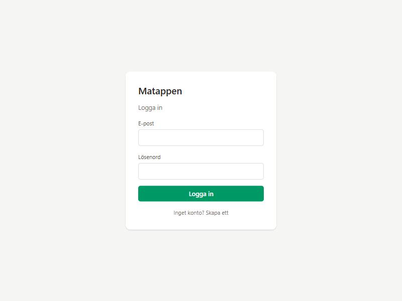

# Matappen

A web app that keeps track of the groceries at home, shows which dishes I can cook, and writes the shopping list for me.

> Work in progress. Step 1 (project setup and login) is done.

## Features (planned for version 1)
- **Pantry** – everything at home, grouped by category, with status and amount
- **Staples** – salt, oil, spices etc. that are always assumed to be at home
- **Recipes** – ingredients scaled by servings, instructions, link and notes
- **What can I cook?** – dishes I can make now, or with only 1–2 items missing
- **Meal planning** – pick dishes and the shopping list is created automatically
- **Shopping list** – automatic and manual items; "Done shopping" moves them to the pantry
- **I cooked this** – quickly update what's left after cooking

## Tech
React, Vite, TypeScript, Tailwind CSS and Supabase (database + email/password login).

## Running it locally
1. Install [Node.js](https://nodejs.org) (version 20 or newer).
2. Create a project at [supabase.com](https://supabase.com).
3. Copy `.env.example` to `.env.local` and fill in the Supabase URL and publishable key (Project Settings → API).
4. Install and start:
   ```bash
   npm install
   npm run dev
   ```
5. Open http://localhost:5173

## Screenshots

